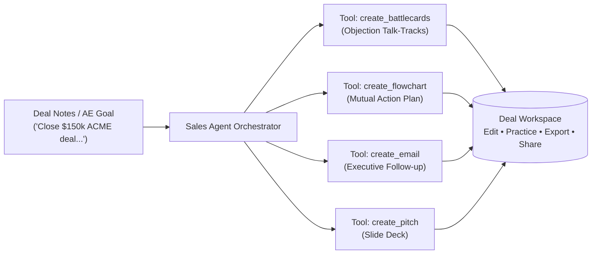

# BUST — AI Sales Planning & Deal Execution Workspace

> **One deal instruction. Multiple sales deliverables.**  
> BUST is an agent-driven workspace for sales teams, account executives (AEs), and revenue leaders. Instead of spending hours juggling separate apps to prepare for enterprise deals, an autonomous AI agent plans, executes deterministic sales tools, validates outputs, and delivers editable, shareable work products: **Objection Battlecards**, **Sales Flowcharts / Mutual Action Plans**, **Deal Outreach Emails**, and **Executive Presentations**.

---

## 1. What is BUST?

Enterprise sales reps spend over 30% of their time manually preparing collateral—drafting follow-up emails, creating mutual action plans, researching competitive objections, and tailoring pitch decks. Existing AI chatbots generate generic text snippets, but don't manage the structured workflow of editing, organizing, validating, and sharing deal collateral.

**BUST transforms raw deal notes into ready-to-use sales assets in seconds.**



---

## 2. Core Sales Artifacts

| Artifact | Purpose in Deal Cycle | Key Features |
| :--- | :--- | :--- |
| **Objection Battlecards** | AE pitch prep & handling tough buyer objections (Pricing, Security, Competitors) | Categorized cards, objection vs winning talk-track, key differentiators, **Interactive AE Pitch Practice Mode** (flip to reveal talk-track) |
| **Sales & Process Flowcharts** | Mutual Action Plans (MAPs), closing timelines, customer onboarding journeys | Mermaid-powered visual diagrams, interactive rendering, step-by-step buyer roadmap, SVG/PNG export |
| **Deal & Outreach Emails** | Cold outbound, post-discovery recaps, champion enablement, executive proposals | Target audience selection, executive tone options, 1-click clipboard copy, mailto export |
| **Executive Presentations** | Discovery briefings, solution overviews, commercial ROI cases | Slide outlines, speaker notes, structured bullets, PowerPoint (`.pptx`) export |

---

## 3. Partner Integrations & Hackathon Evidence

> 🏆 **Full Verification & Incident Resolution Document**: See [**docs/EVIDENCE.md**](file:///workspaces/BUST/docs/EVIDENCE.md) for detailed incident resolution traces, Entire git checkpoints, and cfo.ai financial models.

- **[NeatLogs](https://neatlogs.com/) Observability & Tracing**: Python SDK (`neatlogs[openai]`) with regional ingest (`https://ingest.neatlogs.com`). All LLM calls and sales DAG steps are instrumented with `@neatlogs.span` and client wrapping. We used NeatLogs telemetry to detect and resolve **Incident `INC-20261011-01`** (LLM JSON extraction latency spike & markdown parse failure).
- **[Entire CLI](https://entire.io/) Agent Development**: Automated pre-tool hooks (`.agents/hooks.json`) and git-refs checkpoints (`.entire/settings.json`). Every major agent improvement is preserved across **11+ commits with `Entire-Checkpoint` headers** (`git log --grep="Entire-Checkpoint"`). **Live Public Session**: [entire.io/gh/Viswesh934/BUST/session/77ad5304-ab6c-4459-bb55-06cdea62fa7f](https://entire.io/gh/Viswesh934/BUST/session/77ad5304-ab6c-4459-bb55-06cdea62fa7f).
- **[cfo.ai](https://cfo.ai/) Business Planning & Deal Intelligence**: Connected to the Wysbryx workspace (`Org: 103176`, Scenario: `Main Scenario#52f`). Used to plan BUST's own SaaS pricing tiers ($36k standard / $120k growth / $240k enterprise) and dynamically injects labor savings, ARR payback days, and ROI multipliers into generated pitch decks, battlecards, and emails (`backend/app/tools/cfo.py`).
- **AI Gateway**: Hackathon [LiteLLM](https://litellm.ai/) endpoint (`https://litellm.vision.aivar.app/v1`, using `nova-pro`) via OpenAI-compatible SDK.
- **Frontend**: [Astro](https://astro.build/) (`frontend/`) — Responsive, fast deal workspace UI.
- **Backend**: Python + [FastAPI](https://fastapi.tiangolo.com/) (`backend/`) — Agent orchestrator, deterministic sales tools, and artifact store.

---

## 4. Phased Roadmap

| Milestone | Status | Description |
| :--- | :---: | :--- |
| **M1: Foundation** | ✅ **Done** | Scaffold Astro + FastAPI, LiteLLM gateway, NeatLogs observability, Entire & cfo.ai connections. |
| **M2: First Sales Artifact** | 🔄 *Next* | Objection Battlecards: generation from deal context, editing, persistent storage, and AE Pitch Practice Mode. |
| **M3: Deal Room Sharing** | 📅 *Planned* | Public read-only deal room links (`/share/:id`) for prospective buyers or internal review. |
| **M4: DAG Agent Engine** | 📅 *Planned* | Autonomous sales DAG engine: parses deal goals into dependency graphs, executes parallel steps, pipelines context, and self-heals retries. |
| **M5: Full Sales Suite** | 📅 *Planned* | Add Mermaid Mutual Action Plans, tone-adaptive deal emails, and executive pitch decks with PPTX export. |
| **M6: Hackathon Demo** | 📅 *Planned* | Showcase live enterprise deal simulation: 1 AE prompt $\rightarrow$ 3 sales deliverables, live NeatLogs trace, Entire checkpoints, and cfo.ai model. |

> Detailed technical specifications, JSON schemas, and milestone tasks are documented in the [Planning Document](file:///workspaces/BUST/docs/PLANNING.md).

---

## 5. Getting Started

### Prerequisites
- Node.js ≥ 22.12
- Python ≥ 3.10, < 3.14 (Python 3.13 recommended)

### 1. Backend Setup
```bash
# Navigate to backend
cd backend

# Create virtual environment and install dependencies
python3.13 -m venv .venv
source .venv/bin/activate
pip install -r requirements.txt

# Configure backend/.env
# Set LITELLM_API_KEY, LITELLM_BASE_URL, LITELLM_MODEL, NEATLOGS_API_KEY

# Run server
uvicorn app.main:app --host 0.0.0.0 --port 8000 --reload
```

### 2. Frontend Setup
```bash
# Navigate to frontend
cd frontend

# Install dependencies
npm install

# Run development server
npm run dev -- --host 0.0.0.0 --port 4321
```

### 3. Verify Health & Tracing
- Open `http://localhost:4321` in your browser.
- Click **Check /health** to test FastAPI connectivity.
- Click **Test LLM** to execute an instrumented model completion logged to NeatLogs.