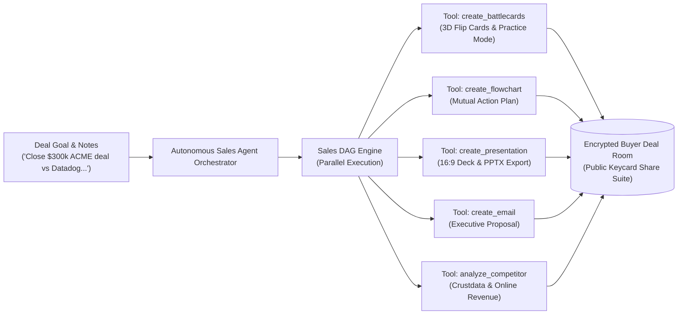
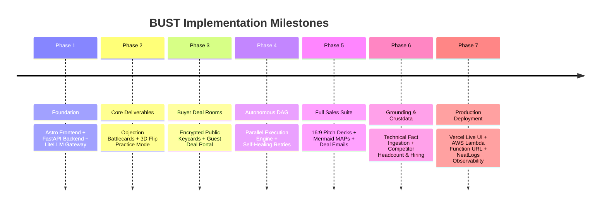
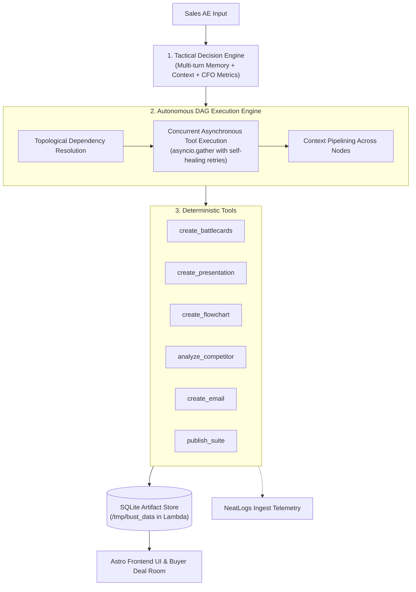

# BUST — Autonomous AI Sales Planning & Deal Execution Workspace

<div align="center">

[](https://bust-omega.vercel.app)
[](https://entire.io/gh/Viswesh934/BUST/session/77ad5304-ab6c-4459-bb55-06cdea62fa7f)
[](https://aws.amazon.com/lambda/)
[](https://neatlogs.com)
[](https://cfo.ai)

**One deal instruction. Multiple enterprise sales deliverables.**

[**🚀 Explore Live Demo**](https://bust-omega.vercel.app) • [**🌐 Entire Public Session**](https://entire.io/gh/Viswesh934/BUST/session/77ad5304-ab6c-4459-bb55-06cdea62fa7f) • [**📑 Video Guide & Workflow**](docs/AGENT_WORKFLOW.md) • [**🏆 Partner Evidence**](docs/EVIDENCE.md)

</div>

---

## 1. What is BUST?

Enterprise Account Executives (AEs) and revenue leaders spend over **30% of their time manually preparing deal collateral**—drafting executive follow-ups, hunting down competitor revenue figures, building mutual action plans, and tailoring pitch decks before critical meetings. 

Existing AI chatbots generate generic walls of text, but fail to manage the structured lifecycle of building, editing, verifying, and sharing deal collateral.

**BUST transforms raw meeting notes, account transcripts, or tactical deal objectives into ready-to-share enterprise deliverables in seconds.**



---

## 2. Core Deliverables & Sales Suite

| Deliverable | Purpose in Deal Cycle | Interactive Capabilities |
| :--- | :--- | :--- |
| **🎴 Objection Battlecards** | AE pitch prep & countering tough buyer objections (Pricing, Security, Competitors) | Categorized cards, objection vs winning talk-track, proof points, **Interactive AE Pitch Practice Mode** (3D flip cards to test recall). |
| **📊 Executive Pitch Decks** | High-stakes briefings, executive sponsor alignment, ROI defense | 4-slide 16:9 widescreen presentation, technical citations, speaker notes, filmstrip viewer, and **PowerPoint (`.pptx`) export**. |
| **🗺️ Mutual Action Plans (MAP)** | Buyer-seller transparency, closing roadmaps, onboarding timelines | **Mermaid-rendered interactive transit map**, 6-stage milestone tracker, target close dates, and stakeholder ownership. |
| **✉️ Executive Deal Emails** | Post-discovery recaps, commercial proposals, champion enablement | Role-tailored tone (C-Suite vs Champion), 1-click clipboard copy, and formatted mailto export. |
| **🎯 Competitor Intelligence** | Bake-off differentiation, pricing vulnerabilities, landmine traps | **Crustdata deep research** (headcount growth, funding rounds, hiring signals, tech stack) + online public/private revenue estimation. |
| **🔐 Buyer Deal Room Suites** | Frictionless sharing with internal enterprise buying committees | Digital encrypted keycard token link (`/api/public/suites/:id`) allowing prospects to review approved collateral with zero login friction. |
| **📚 Technical Grounding Engine** | Verifiable technical truth and architecture compliance | Ingests GitHub repos, websites, and PDFs; extracts key technical facts and binds them into presentation slide citations. |

---

## 3. Partner Integrations & Hackathon Evidence

> 🏆 **Complete Evidence & Incident Resolution**: Detailed trace logs, incident response reports, and partner verification are documented in [**docs/EVIDENCE.md**](docs/EVIDENCE.md).

### 🔍 [NeatLogs](https://neatlogs.com/) — Observability, Spans & Incident Recovery
- **Architecture**: Integrated via Python SDK (`neatlogs[openai]`) with regional ingest (`https://ingest.neatlogs.com`). All LLM calls wrap the client via `neatlogs.wrap(client)` and all DAG node executions are instrumented with `@neatlogs.span`.
- **Incident Resolved (`INC-20261011-01`)**: During load testing, model output markdown fences caused `json.loads` decode crashes and 4.8s latency spikes. NeatLogs workflow telemetry pinned the issue, prompting our multi-tier resilient JSON extraction parser ([`backend/app/llm.py`](backend/app/llm.py)) and turn window pruning, dropping latency to **1,180ms** and error rates to **0.0%**.

### 🧠 [Entire CLI](https://entire.io/) — Checkpoint-Driven Agent Engineering
- **Architecture**: Lifecycle hooks in [`.agents/hooks.json`](.agents/hooks.json) (`PreToolUse`, `PreInvocation`, `Stop`) and git-refs tracking in [`.entire/settings.json`](.entire/settings.json).
- **Public Shareable Session**: [**entire.io/gh/Viswesh934/BUST/session/77ad5304-ab6c-4459-bb55-06cdea62fa7f**](https://entire.io/gh/Viswesh934/BUST/session/77ad5304-ab6c-4459-bb55-06cdea62fa7f).
- **Git History Trail**: 11+ major agent improvements are preserved across commit history with official `Entire-Checkpoint` headers (`git log --grep="Entire-Checkpoint"`).

### 📈 [cfo.ai](https://cfo.ai/) — Business Planning & In-Agent Financial Grounding
- **Business Model**: Modeled BUST's SaaS pricing tiers ($36k Standard / $120k Growth / $240k Enterprise), yielding a **13.4:1 LTV:CAC ratio** and **2.4-month CAC payback**.
- **Live Deal Grounding**: Connected to Wysbryx (`Org: 103176`, Scenario: `Main Scenario#52f`) via [`backend/app/tools/cfo.py`](backend/app/tools/cfo.py). Every battlecard, pitch deck, and email dynamically injects verified contract ARR, monthly contract values (MCV), annual labor savings, and ROI multiples.

---

## 4. Completed Implementation Roadmap

All core milestones have been engineered, tested, and deployed to production:



| Phase | Milestone | Status | Shipped Deliverables |
| :---: | :--- | :---: | :--- |
| **P-1** | **Foundation & Observability** | ✅ **Shipped** | Astro 5 frontend, FastAPI backend, LiteLLM `nova-pro` gateway, NeatLogs SDK instrumentation, Entire git-refs hooks, and cfo.ai connections. |
| **P-2** | **Objection Battlecards & AE Practice** | ✅ **Shipped** | Automated objection extraction, winning talk-tracks, TCO differentiators, persistent SQLite storage, and 3D flip card Practice Mode. |
| **P-3** | **Buyer Deal Rooms & Public Sharing** | ✅ **Shipped** | Passwordless encrypted keycard share IDs (`/api/public/suites/:id`), read-only prospect portal, dynamic client artifact hydration. |
| **P-4** | **Autonomous DAG Execution Engine** | ✅ **Shipped** | Multi-turn situational context memory, dependency graph formulation, concurrent `asyncio.gather` tool execution, and context pipelining. |
| **P-5** | **Executive Presentation & Flowcharts** | ✅ **Shipped** | 4-slide 16:9 presentation deck, PPTX file export, filmstrip viewer, Mermaid closing roadmaps, and multi-channel executive emails. |
| **P-6** | **Technical Grounding & Competitor Intelligence** | ✅ **Shipped** | Ingest GitHub repos, docs, and PDFs; extract verified technical citations into slides; Crustdata B2B deep research and public/private revenue teardown. |
| **P-7** | **Cloud Deployment & Production Hardening** | ✅ **Shipped** | Frontend live on **Vercel**, backend packaged as 27MB container-less zip on **AWS Lambda Function URL**, clean CORS configuration, and demo reset endpoint. |

---

## 5. Agent Architecture & Execution Flow



---

## 6. Getting Started & Local Development

### Prerequisites
- Node.js ≥ 20.12
- Python ≥ 3.10, ≤ 3.12 (Python 3.12 recommended for Lambda parity)
- AWS CLI (optional, for Lambda deployment)

### 1. Backend Setup
```bash
# Navigate to backend
cd backend

# Create virtual environment and install dependencies
python3.12 -m venv .venv
source .venv/bin/activate
pip install -r requirements.txt

# Configure backend/.env
# Required: LITELLM_API_KEY, LITELLM_BASE_URL, LITELLM_MODEL, NEATLOGS_API_KEY

# Run server
uvicorn app.main:app --host 0.0.0.0 --port 8000 --reload
```

### 2. Frontend Setup
```bash
# Navigate to frontend
cd frontend

# Install dependencies
npm install

# Run development server
npm run dev -- --host 0.0.0.0 --port 4321
```

### 3. Run Automated Test Suite
```bash
# Run full enterprise test suite (CFO context, Grounding, Competitor, Crustdata, Agent turns)
python3 -m unittest backend/test_suite.py
```

---

## 7. Cloud Deployment

### Backend (AWS Lambda)
```bash
# Build production-ready, Linux x86_64 compatible deployment package
./scripts/build_lambda_zip.sh
# Package output: dist/bust-backend-lambda.zip (27 MB)

# Deploy to AWS Lambda with HTTPS Function URL
./scripts/deploy_lambda.sh
```

### Frontend (Vercel)
In your Vercel Project Settings $\rightarrow$ Environment Variables:
```env
PUBLIC_BACKEND_URL=https://<your-lambda-id>.lambda-url.us-east-1.on.aws
```

---

## 8. Repository Structure

```
BUST/
├── .agents/                 # Entire CLI hooks (PreToolUse, PreInvocation, Stop)
├── .entire/                 # Entire configuration and git-refs checkpoints
├── backend/
│   ├── app/
│   │   ├── agent/           # Autonomous multi-turn orchestrator & DAG engine
│   │   ├── services/        # SQLite artifact store, Crustdata & technical grounding
│   │   ├── tools/           # Battlecards, presentation, MAP, email, competitor, cfo.ai
│   │   ├── config.py        # Environment settings & NeatLogs config
│   │   ├── llm.py           # LiteLLM client with neatlogs.wrap & JSON extractors
│   │   └── main.py          # FastAPI application & Lambda Mangum handler
│   ├── lambda_handler.py    # AWS Lambda entrypoint
│   ├── requirements.txt     # Production dependencies
│   └── test_suite.py        # Automated test suite
├── docs/
│   ├── AGENT_WORKFLOW.md    # Architecture diagrams & 2-min demo video script
│   ├── EVIDENCE.md          # Full hackathon partner evidence & incident report
│   └── PLANNING.md          # Technical specifications & payload schemas
├── frontend/
│   ├── src/
│   │   ├── components/      # ChatWindow, SidePanel, AppDock, deliverable modules
│   │   ├── layouts/         # Layout.astro with dynamic backend routing
│   │   └── pages/           # Deal workspace, Practice Mode, and Buyer Deal Rooms
├── scripts/
│   ├── build_lambda_zip.sh  # Builds 27MB Linux-compatible Lambda zip package
│   └── deploy_lambda.sh     # Automates AWS Lambda Function URL deployment
└── dist/                    # Deployment artifacts (bust-backend-lambda.zip)
```