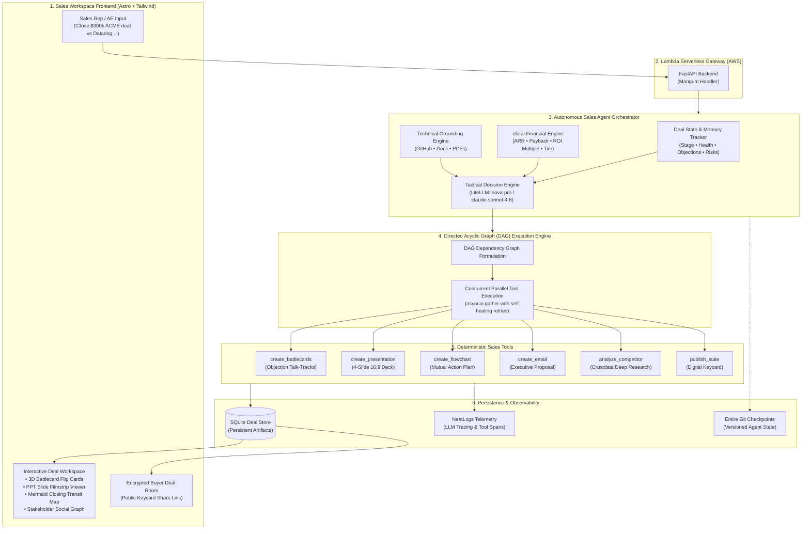
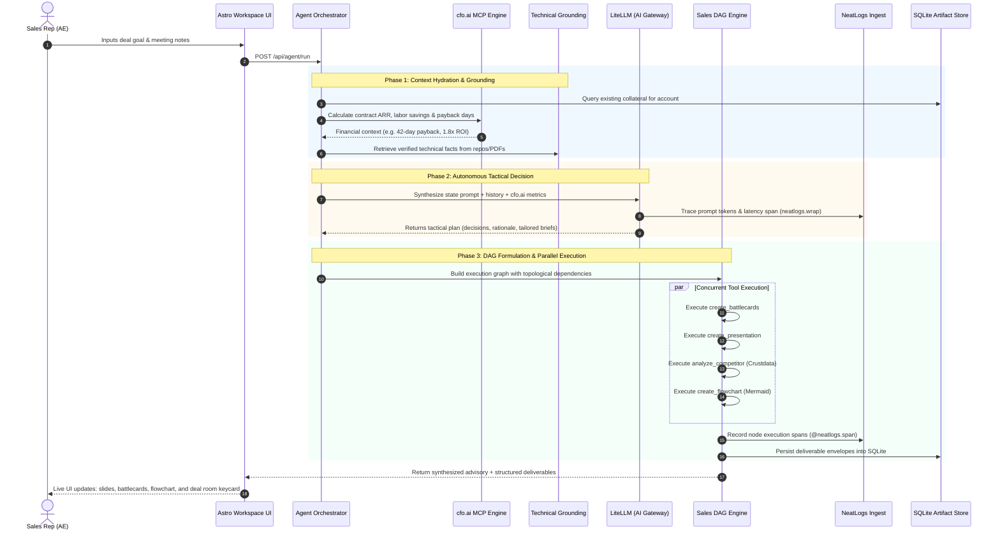
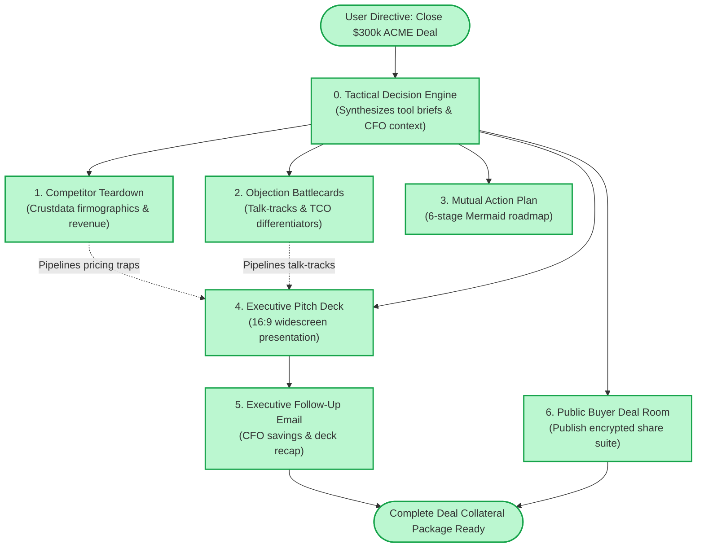

# BUST — Agent Workflow & Demo Video Guide

> **Visual Workflow Diagrams, Architecture Deep-Dive, and 2-Minute Demo Video Script**  
> Tailored for presenting **BUST** at hackathon demo days, investor pitches, and partner evaluations (**NeatLogs**, **Entire**, and **cfo.ai**).

---

## 1. High-Level System Architecture

---

## 2. The 5-Stage Agent Lifecycle (Step-by-Step Flow)

---

## 3. Autonomous Sales DAG Engine: Parallel Dependency Graph

When the agent decides which deliverables to build, it doesn't run a slow, brittle sequential loop. It builds an autonomous **Directed Acyclic Graph (DAG)**:

---

## 4. 2-Minute Demo Video Script & Storyboard

Use this exact script and timing for your video presentation:

| Timestamp | Visual on Screen | Voiceover Script (What to Say) |
| :--- | :--- | :--- |
| **0:00 – 0:20** *(The Problem)* | Show messy Google Drive / desktop folders with separate pitch decks, docs, and notes. Then open **BUST** (`bust-omega.vercel.app`). | *"Enterprise account executives spend over 30% of their week manually prepping deal collateral—drafting follow-ups, hunting down competitor data, and tailoring decks. Existing AI chatbots generate generic text snippets, but don't manage the real workflow of building, editing, and sharing deal-winning collateral. Meet **BUST**: One deal instruction, multiple sales deliverables."* |
| **0:20 – 0:45** *(The Live Prompt & Agent)* | Type into BUST Chat: `Close a $300k ARR deal with ACME Corp against Datadog. CTO raised pricing and data residency concerns. Build battlecards, an executive deck, and a mutual action plan.` Hit Enter. | *"I simply tell BUST the deal goal and prospect objections. Immediately, our autonomous multi-turn agent kicks off. Instead of running a generic prompt, BUST queries our database for existing account context, pulls live financial metrics from **cfo.ai**, and formulates a Directed Acyclic Graph to execute deterministic tools in parallel."* |
| **0:45 – 1:10** *(Deliverables Tour)* | Click through the generated tabs in BUST: 1. **Battlecards** (flip a card). 2. **Pitch Deck** (cycle slides). 3. **Mutual Action Plan**. 4. **Competitor** (Datadog revenue & Crustdata). | *"In seconds, BUST delivers an entire deal suite: **Objection Battlecards** with 3D flip cards for rapid AE pitch practice; a **4-slide 16:9 Executive Pitch Deck** grounded in verified technical citations; a visual **Mutual Action Plan** with milestone dates; and deep competitor intelligence powered by **Crustdata**."* |
| **1:10 – 1:35** *(Partners: NeatLogs, Entire, cfo.ai)* | Quickly show: 1. **NeatLogs Dashboard** / Trace. 2. **Entire Session Link**. 3. Slide 4 highlighting **cfo.ai ROI numbers**. | *"Under the hood, three core technologies power BUST: • **NeatLogs** provides end-to-end observability, tracing every LLM turn and tool span to resolve latency bottlenecks. • **Entire** tracks our agent development checkpoints across git history, giving us verifiable prompt improvement. • And **cfo.ai** plans our business unit economics while dynamically grounding every deliverable in real contract ARR, labor savings, and payback metrics."* |
| **1:35 – 2:00** *(Buyer Deal Room & Outro)* | Click **Publish Deal Room**, show the generated public link (`/api/public/suites/:id`) opening in a guest window. | *"Finally, with one click, BUST publishes a passwordless, encrypted Buyer Deal Room for the prospect champion to share internally with their CFO. That's BUST—turning deal notes into closed enterprise contracts in seconds."* |

---

## 5. Key Highlights to Emphasize in the Presentation
1. **Not Just a Chatbot**: An autonomous decision engine that formulates a **DAG of deterministic tools**, pipelines context between nodes, and self-heals retries.
2. **Deep Observability with NeatLogs**: Real production telemetry (`workflow: llm-completion`) tracing prompt tokens, tool latencies, and automated incident recovery.
3. **Verifiable Development with Entire**: 11+ git checkpoints recorded with immutable Entire hashes ([Live Entire Session](https://entire.io/gh/Viswesh934/BUST/session/77ad5304-ab6c-4459-bb55-06cdea62fa7f)).
4. **Financial Grounding with cfo.ai**: Enterprise deals close on ROI; BUST embeds verified payback periods directly into customer-facing slides.
