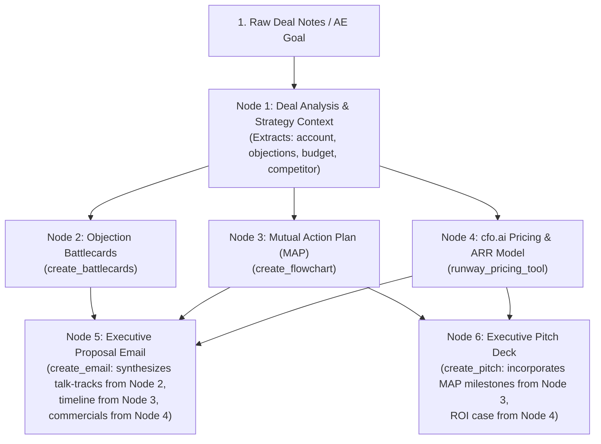

# BUST — Sales Planning & Deal Execution Workspace
## Phased Implementation & Technical Planning Document

> **The Core Premise**: *One instruction. Multiple sales deliverables.*  
> BUST is an agent-driven workspace for sales teams, account executives, and revenue leaders. From raw meeting notes, account transcripts, or deal objectives, an orchestrating AI agent plans, executes deterministic tools, validates outputs, and delivers editable, shareable sales artifacts: **Objection Battlecards**, **Sales Flowcharts**, **Deal Outreach Emails**, and **Executive Presentations**.

---

## 1. System Architecture Overview

```mermaid
flowchart TD
    User["Sales AE / Revenue Lead Prompt"] --> Frontend["Astro Sales Workspace UI"]
    Frontend -->|"POST /api/agent/run"| API["FastAPI Backend"]
    
    subgraph Agent Loop ["FastAPI Sales Agent Engine"]
        Planner["1. Sales Strategy Planner\n(LiteLLM: nova-pro/claude)"]
        Exec["2. Deterministic Sales Tools\n(create_battlecards, create_flowchart, create_email, create_pitch)"]
        Val["3. Schema Validation & Guardrails"]
        Planner --> Exec --> Val
        Val -->|"Retry on Failure"| Planner
    end
    
    API --> Agent Loop
    Agent Loop -->|"Store JSON Artifacts"| Storage[("Artifact Store\n(JSON / File / SQLite)")]
    Agent Loop -.->|"Trace Spans & Latency"| NeatLogs["NeatLogs Observability"]
    
    Storage --> ReadAPI["GET /api/artifacts/:id"]
    ReadAPI --> Frontend
    ReadAPI --> PublicShare["Public Deal Room / Share Link (/share/:id)"]
    
    Entire["Entire CLI Workflow"] -.->|"Track Agent Sessions"| API
    CFO["cfo.ai MCP (Financial Modeling & Projections)"] -.->|"Pricing & ARR Projections"| Planner
```

---

## 2. Core Sales Data Models (Structured Artifact Schemas)

Every artifact in BUST has a unified envelope schema with a type-specific `content` payload:

### Unified Envelope
```json
{
  "id": "art_9f82b1",
  "type": "battlecards | presentation | flowchart | email",
  "title": "Enterprise Deal Strategy — ACME Corp",
  "deal_context": {
    "account_name": "ACME Corp",
    "deal_size": "$120,000 ARR",
    "stage": "Proposal / Negotiation"
  },
  "created_at": "2026-10-10T12:00:00Z",
  "updated_at": "2026-10-10T12:05:00Z",
  "is_published": false,
  "share_id": "sh_a8b29c",
  "content": { ... }
}
```

### Type-Specific Payload Schemas

#### 1. Objection Battlecards Payload
*Replaces academic flashcards with sales objection handling & competitive battlecards for rapid AE prep.*
```json
{
  "deck_name": "ACME Corp — Enterprise Objection Handling & Battlecards",
  "target_competitor": "LegacyVendor Corp",
  "cards": [
    {
      "id": "card_1",
      "category": "Pricing / Budget",
      "objection": "Your solution is 20% more expensive than our current renewal quote from LegacyVendor.",
      "talk_track": "Acknowledge the price difference, then pivot to total cost of ownership (TCO). Highlight that LegacyVendor requires 2 FTEs for maintenance and lacks automated workflows, saving them $80k/yr in operational overhead.",
      "key_differentiators": ["Zero-maintenance architecture", "3x faster onboarding", "Native cfo.ai runway visibility"],
      "order": 1
    },
    {
      "id": "card_2",
      "category": "Security & Compliance",
      "objection": "We require SOC2 Type II and regional data residency.",
      "talk_track": "Confirm our SOC2 Type II certification and note that data residency is strictly contained within their chosen AWS region.",
      "key_differentiators": ["SOC2 Type II certified", "AWS GovCloud & EU region support"],
      "order": 2
    }
  ]
}
```

#### 2. Sales Flowchart Payload
*Deal stages, Mutual Action Plans (MAP), or customer onboarding architectures.*
```json
{
  "syntax": "mermaid",
  "flowchart_type": "mutual_action_plan",
  "code": "graph TD\n  Discovery[1. Discovery Call Completed] --> TechReview[2. Technical Architecture Review]\n  TechReview --> Security[3. Security & Compliance Sign-off]\n  Security --> Legal[4. MSA & Commercials Review]\n  Legal --> CFOApproval[5. CFO & Finance Sign-off]\n  CFOApproval --> Close[6. Contract Signature & Kickoff]",
  "nodes_summary": ["Discovery", "Technical Review", "Security Sign-off", "Legal & Commercials", "CFO Approval", "Contract Signature"]
}
```

#### 3. Sales Deal Email Payload
*Outbound prospects, post-demo champion enablement, executive proposals, or contract negotiations.*
```json
{
  "subject": "Executive Summary & Next Steps — BUST x ACME Corp Partnership",
  "recipient_audience": "VP of Revenue Operations",
  "tone": "executive-persuasive",
  "body": "Hi Sarah,\n\nThank you for the productive technical review today. As discussed, BUST will enable your 40-person sales team to eliminate 8+ hours/week of manual deck preparation and objection research.\n\nAttached is our mutual action plan and executive presentation for your CFO review.\n\nBest regards,\nAlex",
  "key_takeaways": [
    "Addresses 8+ hours/week prep overhead",
    "Mutual Action Plan timeline targeted for month-end close",
    "CFO-ready pricing model"
  ]
}
```

#### 4. Sales Pitch Deck / Presentation Payload
*Executive briefing, discovery recap, solution proposal, and ROI business case.*
```json
{
  "presentation_type": "executive_pitch",
  "slides": [
    {
      "slide_number": 1,
      "title": "Unlocking Sales Velocity for ACME Corp",
      "bullets": [
        "The Challenge: 35% of rep time lost to manual collateral prep",
        "The Solution: Agentic workspace generating battlecards, MAPs, and emails in seconds",
        "Projected Impact: 22% higher win rate and $140k annual time savings"
      ],
      "speaker_notes": "Open by framing the problem around rep productivity and quota attainment."
    },
    {
      "slide_number": 2,
      "title": "Commercial Proposal & ROI",
      "bullets": [
        "Annual Subscription: $120,000 for 50 AE licenses",
        "Break-even: Closing just 2 additional deals per quarter",
        "Deployment: Fully operational in 7 business days"
      ],
      "speaker_notes": "Walk through the ROI calculation and align on implementation timeline."
    }
  ]
}
```

---

## 3. Phased Roadmap & Milestones

### Phase 1: Foundation (Milestone 1) — *Completed*
- [x] Scaffold Astro frontend and FastAPI backend.
- [x] Configure backend credentials with `.env` and `.gitignore`.
- [x] Reusable LiteLLM client (`https://litellm.vision.aivar.app/v1`, `nova-pro`).
- [x] NeatLogs tracing integration with regional ingest (`https://ingest.neatlogs.com`).
- [x] Connect Entire CLI checkpointing (`entire enable --agent antigravity`).
- [x] Connect cfo.ai MCP integration (`https://api.cfo.ai/mcp`) for financial & pricing models.
- [x] Live end-to-end test verification (`/health` and `/api/test-llm`).

---

### Phase 2: First Sales Artifact — Objection Battlecards (Milestone 2) — *Completed*
**Goal**: Build an interactive sales battlecard system: generate objection talk-tracks from deal context, edit cards, persist them, and provide an interactive **AE Pitch Practice Mode** (flip to reveal recommended talk tracks and counterpoints).

#### Key Deliverables:
1. **Backend Tool**: `create_battlecards(account_name: str, notes: str, competitor: str = "")`
   - [x] LLM structured prompt producing validated `ObjectionBattlecards` schema (`nova-pro`).
   - [x] Guardrails: checks objection realism, actionable talk track, and key differentiators.
2. **Artifact Store Service**:
   - [x] `save_artifact(artifact: dict)`
   - [x] `get_artifact(id: str) -> dict`
   - [x] `update_artifact(id: str, patch: dict) -> dict`
   - [x] Storage in `backend/data/artifacts/*.json` (lightweight, human-inspectable).
3. **Frontend UI**:
   - [x] Physical 3D stacked deck with side navigation arrows and flip animation.
   - [x] Category filters: Pricing, Security, Competitor Trap.
   - [x] Live generation and persistence via `POST /api/artifacts/battlecards`.

---

### Phase 3: Sales Deal Room & Read-Only Sharing (Milestone 3) — *Completed*
**Goal**: Generate shareable deal room links for prospective buyers or internal sales teams with read-only views.

#### Key Deliverables:
1. **Backend Endpoints**:
   - [x] `POST /api/artifacts/:id/publish` -> generates public hotel keycard `share_id` (e.g. `suite_acmecorp_91f404`).
   - [x] `GET /api/public/suites/:share_id` -> returns unauthenticated read-only payload for guest keycard access.
2. **Frontend Public Deal Suite View**:
   - [x] Luxury Hotel Suite viewer (`/suite/[id].astro`).
   - [x] One-click "Copy Guest Keycard" and "Enter Suite As Guest" links.
   - [x] Zero developer terms, strict read-only guest permissions.

---

### Phase 4: Autonomous Sales Agent with DAG Execution Engine (Milestone 4) — *Completed*
**Goal**: Move from single-tool calls to an autonomous **DAG (Directed Acyclic Graph) execution engine** that parses a complex sales prompt, builds a dependency graph of deliverables, executes parallel steps, pipelines context, and keeps execution going continuously through self-healing retries.

#### The DAG Execution Model:


#### Why DAG Execution Keeps Progress Moving:
1. **Parallel Execution**: Nodes with no mutual dependencies execute concurrently.
2. **Context Pipelining**: Downstream deliverables consume verified JSON outputs from upstream nodes.
3. **Failure Isolation & Resumability**: Localized retry with error feedback resumes downstream execution without restarting from scratch.
4. **Autonomous State Machine**: Ready nodes resolved via topological sorting until the full graph completes.

#### Key Deliverables:
1. **DAG Engine (`backend/app/agent/dag.py`)**:
   - [x] `DAGNode`: `node_id`, `tool_name`, `depends_on: List[str]`, `status`, `result`.
   - [x] `SalesDAGExecutionEngine`: Topological sort, readiness evaluation, and retry isolation.
2. **Agent Planner (`backend/app/agent/orchestrator.py`)**:
   - [x] LiteLLM dynamically extracts intent and parameters, constructing the DAG.
3. **NeatLogs Observability**:
   - [x] Root trace: `@neatlogs.span(kind="WORKFLOW", name="sales-dag-orchestration")`.
   - [x] Child spans per DAG node (`TOOL`) with timing and dependencies.

---

### Phase 5: Multi-Artifact Sales Suite (Milestone 5) — *Completed*
**Goal**: Add the full suite of deal collateral.

#### Key Deliverables:
1. **Sales Flowcharts**:
   - [x] Tool `create_flowchart(account_name, notes, target_date)` producing 6-stage Mutual Action Plans (MAP).
   - [x] Real-time visual roadmap rendering and canvas inspection.
2. **Deal Emails**:
   - [x] Tool `create_email(account_name, recipient, context, tone)`.
   - [x] Subject, Body, and Takeaways with 1-click clipboard copying.
3. **Executive Pitch Decks**:
   - [x] Tool `create_presentation(account_name, context, deal_size)`.
   - [x] 16:9 widescreen presentation slide slider with speaker notes drawer.
4. **Coding Agent IDE Studio (`frontend/src/pages/index.astro`)**:
   - [x] IDE editor aesthetic with docked left chat panel and live right canvas inspector.
   - [x] Step-by-step progress disclosure during execution.
   - [x] Rich inline deliverable output cards in chat turns with 1-click canvas navigation.
   - [x] Zero-scroll tabbed inspector for all collateral.

---

### Phase 6: Hackathon Demonstration Readiness (Milestone 6)
**Goal**: Deliver a polished, compelling presentation highlighting autonomous agency, real sales value, and integrations.

#### Showcase Scenario:
> **Single AE Instruction**: *"We just finished discovery with TechCorp for a $150k ARR deal replacing LegacyCRM. Generate our competitive battlecards with pricing objection handling, a 6-step Mutual Action Plan flowchart, and an executive proposal email to their VP of Sales."*

1. **Autonomous Planning**: Shows the agent creating all 3 deliverables simultaneously.
2. **Interactive Battlecards**: Review objections and practice pitches with card flip.
3. **Mutual Action Plan Flowchart**: Live interactive visual diagram showing clear path to signature.
4. **CFO Integration**: Demonstrates cfo.ai financial context (deal ARR, contract value, and ROI).
5. **NeatLogs Observability**: Shows the live trace in NeatLogs with tool execution timings.
6. **Entire Workflow**: Demonstrates checkpoint history and git-native agent traceability.
